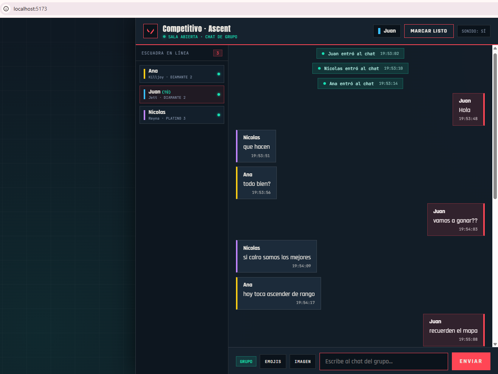
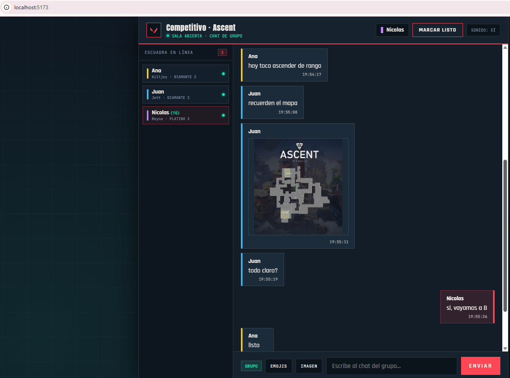
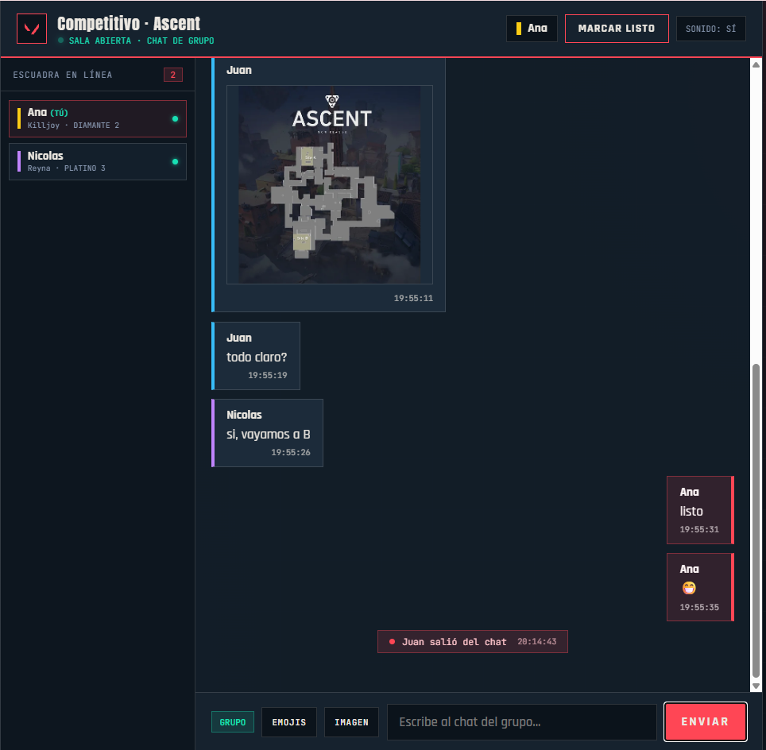
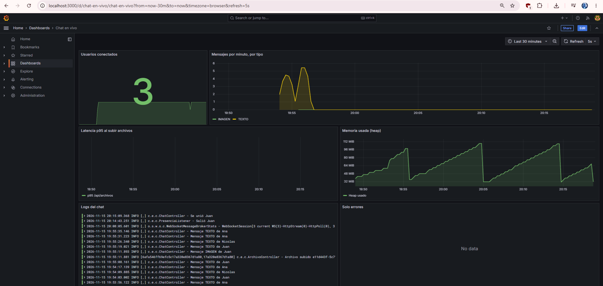

# chat-server

Servidor de chat en tiempo real construido con **Spring Boot 3.5.16**, **Java 21**, **WebSocket + STOMP** y **observabilidad** (Prometheus, Loki, Zipkin y Grafana).

## Qué hace y cómo se conecta con `chat-client`

- Expone el endpoint WebSocket STOMP `ws://localhost:8080/ws` (`WebSocketConfig`) donde se conecta el cliente React ([chat-client](../chat-client), corriendo en `http://localhost:5173`).
- Gestiona entrada/salida de usuarios (`ChatController`, `PresenciaListener`, `UsuariosConectados`) y retransmite mensajes a la sala.
- Expone endpoints REST auxiliares con CORS habilitado para `http://localhost:5173`:
  - `POST /api/archivos` y `GET /api/archivos/{nombre}` (`ArchivoController`, límite 5 MB) para subir y servir imágenes.
  - `GET /api/usuarios` para consultar la lista actual de conectados.

## Cómo correrlo en local

**Requisitos:** Java 21, Maven y Docker Desktop (para observabilidad).

1. Entra al repositorio y arranca el servidor:
   ```bash
   mvn spring-boot:run
   ```
2. El servidor quedará escuchando en `http://localhost:8080`.
3. Arranca también `chat-client` (`npm run dev`) para usar la interfaz web en `http://localhost:5173`.

## Destinos STOMP

| Dirección | Destino | Descripción |
| :--- | :--- | :--- |
| Cliente → Servidor | `/app/chat.unirse` | Registra al jugador y su agente seleccionado, publica `UNION` en `/topic/sala` y actualiza `/topic/usuarios`. |
| Cliente → Servidor | `/app/chat.enviar` | Recibe mensajes (`TEXTO`, `IMAGEN`, `AUDIO`), agrega la hora y los retransmite a `/topic/sala`. |
| Servidor → Cliente | `/topic/sala` | Canal al que se suscriben todos los clientes para recibir mensajes y avisos de entrada/salida. |
| Servidor → Cliente | `/topic/usuarios` | Canal con la lista actualizada de jugadores conectados (`nombre` y `agente`). |

## Tema y funciones extra

El sistema completo está tematizado como **Lobby Gamer de Valorant** e incluye:
- **Imágenes:** subida por HTTP (`POST /api/archivos`) y difusión de la URL por WebSocket.
- **Quién está conectado:** seguimiento de sesiones activas y publicación en `/topic/usuarios`.
- **Emojis:** selector integrado en el cliente React.







## Cómo levantar la observabilidad

1. Abre **Docker Desktop** y asegúrate de que `chat-server` esté corriendo en el puerto `8080`.
2. Entra a la carpeta `observabilidad/` y levanta los servicios:
   ```bash
   cd observabilidad
   docker compose up -d
   ```
3. Servicios disponibles:
   - **Prometheus:** `http://localhost:9090` (verifica `http://localhost:9090/targets` en estado `UP`).
   - **Loki:** `http://localhost:3100` (recibe logs con `traceId` desde `logback-spring.xml`).
   - **Zipkin:** `http://localhost:9411` (recibe trazas HTTP como `POST /api/archivos`).
   - **Grafana:** `http://localhost:3000` (usuario inicial `admin` / `admin`).
4. En Grafana importa el tablero versionado en [`observabilidad/dashboard-chat.json`](observabilidad/dashboard-chat.json) (**Dashboards → New → Import**).
5. Al terminar, apaga el stack con:
   ```bash
   docker compose down
   ```


